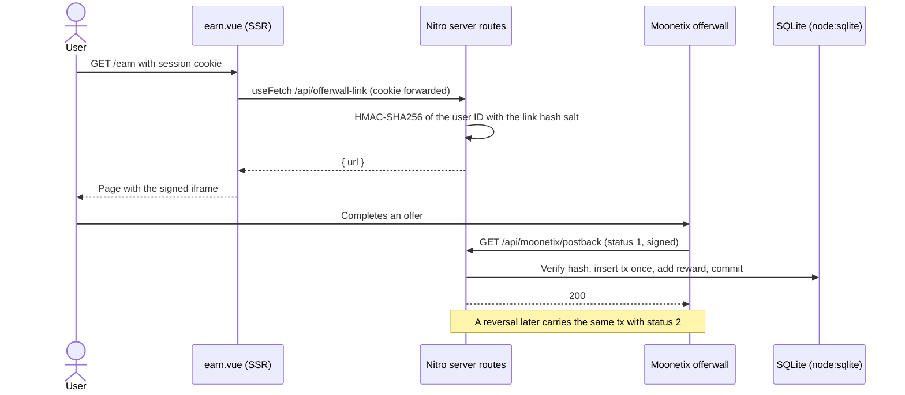

# Moonetix Offerwall for Vue and Nuxt

**A Nuxt 4 app that gets the signed offerwall link from a server route and credits completed offers from a verified postback route.**

[](https://github.com/moonetix/offerwall-vue-nuxt/actions/workflows/ci.yml)
[](LICENSE)
[](https://docs.moonetix.com/offerwall-link)
[](https://moonetix.com/register?from=github-offerwall-vue-nuxt)
[](https://moonetix.com/academy/integrations/vue-nuxt-offerwall)
[](https://moonetix.com/integrations/website)

Vue never touches a key and never adds a coin. Nitro server routes sign the [Moonetix](https://moonetix.com) offerwall link for the session user and apply every credit and reversal, while the page only renders what the server returns. Moonetix is a pay-per-result affiliate network: your users earn your own currency by completing offers, and you earn per completed offer.

> **Get your App ID and keys: sign up free at https://moonetix.com/register?from=github-offerwall-vue-nuxt**

## What is in it

1. **Server-only secrets.** The link hash salt and postback key sit in private `runtimeConfig` with empty defaults, read per request. A search of `.output/public` for either key finds nothing, and a test checks the rendered page as well.
2. **Exactly-once crediting.** `transaction_id` is the primary key of the ledger on `node:sqlite`. Retries, duplicates and a credit that arrives after its reversal pay nothing, and a reversal takes back the stored amount once.
3. **A core you can test without Nuxt.** Signing, hash checks and the ledger live in `server/lib`, plain ES modules with no Nuxt import. `node --test` covers them in under a second, and a second suite runs against the production build.

## Request flow



## Quick start

Node.js 22.13 or later.

```bash
git clone https://github.com/moonetix/offerwall-vue-nuxt.git
cd offerwall-vue-nuxt
npm install
cp .env.example .env              # Moonetix keys and a SESSION_SECRET of 32+ characters
npm run create-user -- demo       # prints a random password
npm run dev                       # http://localhost:3000
```

For production: `npm run build`, then `npm start` (it loads `.env` with `--env-file-if-exists`). On a host, set real environment variables instead; a built Nuxt server does not read `.env` by itself.

| Variable | Required | Default | What it is |
| --- | --- | --- | --- |
| `MOONETIX_APP_ID` | yes | none | Dashboard, Offerwalls, your offerwall, Integration. |
| `MOONETIX_LINK_SALT` | yes | none | Same section: the link hash salt. Signs offerwall links. |
| `MOONETIX_POSTBACK_KEY` | yes | none | Postback page: the postback secret key. Signs postbacks. |
| `SESSION_SECRET` | yes | none | 32 or more random characters. Seals the demo session cookie. |
| `DATABASE_PATH` | no | `./data/app.sqlite` | SQLite file. The folder is created on first use. |
| `PORT` | no | `3000` | Read by the built Nitro server (`npm start`). |

The Nuxt-style names `NUXT_MOONETIX_APP_ID`, `NUXT_MOONETIX_LINK_SALT` and `NUXT_MOONETIX_POSTBACK_KEY` work too and take precedence. Never put a key under `runtimeConfig.public` or in a `NUXT_PUBLIC_` or `VITE_` variable: those reach the browser.

Postback URL for the Postback page of your dashboard:

```text
https://yoursite.com/api/moonetix/postback?tx={transaction_id}&user={user_id}&reward={reward}&status={status}&event={event_id}&payout={payout}&offer={offer_name}&hash={hash}
```

The iframe only loads on https pages of the website you registered for the app. On `localhost` it stays blank; open the signed link in its own tab or use an https staging host.

## Layout

| Path | Role |
| --- | --- |
| `server/lib/moonetix.js` | `wallUrl`, `readParams`, `validHash`, `handlePostback`, exact amounts. No Nuxt import. |
| `server/lib/store.js` | `node:sqlite` schema and the credit and reversal transaction |
| `server/api/moonetix/postback.get.ts` | The postback route. Other methods get 405. |
| `server/api/offerwall-link.get.ts` | `{ url }` for the session user. 401 signed out, 403 before the age check. |
| `server/api/me.get.ts`, `age.post.ts` | Balance, recent rewards, 16+ confirmation |
| `server/api/login.post.ts`, `logout.post.ts`, `server/utils/moonetix.ts` | Demo session on h3 `useSession`. Replace with your auth. |
| `server/middleware/same-origin.ts` | Rejects cross-site POSTs |
| `app/pages/earn.vue`, `app/components/OfferwallFrame.vue` | The Earn page and the iframe |
| `app/composables/useOfferwallLink.ts`, `useRefreshOnReturn.ts` | Link fetch, balance refresh when the tab comes back |

To move this into an existing Nuxt app, copy `server/lib`, `server/api/moonetix`, `server/api/offerwall-link.get.ts`, the `runtimeConfig` block and the two composables, and make `getCurrentUser()` return your signed-in user. For PostgreSQL, keep the pattern: `INSERT ... ON CONFLICT DO NOTHING` decides a credit, a conditional `UPDATE ... WHERE status = 1 RETURNING` decides a reversal, both inside one transaction on one client.

## Security notes

- The link is signed in a server route for the user in the session. A `user_id` in the query string is ignored, and the response is `private, no-store`.
- `useFetch` with a relative URL forwards the cookie during server rendering. A bare `$fetch` in `setup` would not, and the page would render signed out.
- The postback hash is checked before anything else, with a byte-length check ahead of `timingSafeEqual`. `getQuery` turns a repeated key into an array; `readParams` rejects it, so it fails the hash check.
- Balances are integers in millionths of a coin. `0.75 + 1.23456` is exact.
- A reversal may take a balance below zero if the coins were already spent. Say in your terms that rewards can be taken back.
- `payout`, `event` and `offer` are not signed. The offer name is stored for display only.
- Keep `server/middleware` from redirecting `/api/moonetix/postback`; Moonetix does not follow redirects. Do not deploy with `nuxt generate` only: a static build cannot sign links or take postbacks.
- Reward users only for completed offers, never for sign-ups, invites, likes, reviews or other engagement. Users must be 16 or older.

## Tests

```bash
npm test                          # server/lib, no build needed
npm run build && npm run test:built
```

```text
# tests 17   (npm test)
# tests 2    (npm run test:built)
```

`test/fixtures/moonetix-vectors.json` holds links and postbacks made by the Moonetix link and postback code with fake keys (`demoapp0000000000000001`, `test_link_salt_not_secret`, `test_postback_key_not_secret`). `npm test` replays them through `handlePostback` and the store: credit, retry, decimals, reversal, reversal before credit, negative balance, `test_` postbacks, unknown users, tampered values, uppercase, missing and repeated hashes, a missing key and a forced database failure. `npm run test:built` starts `.output/server/index.mjs` with a temporary database and checks postbacks over HTTP, 405 for POST, the guest redirect, sign-in, the age check, cross-site POSTs, and that the server-rendered iframe carries the signed link for the session user.

A signed postback by hand against `npm run dev`, with your key in the shell and demo user 1:

```bash
TX=local_1 U=1 R=150 S=1
HASH=$(node -e 'console.log(require("node:crypto").createHmac("sha256", process.env.MOONETIX_POSTBACK_KEY).update(process.argv[1]).digest("hex"))' "$TX:$U:$R:$S")
curl -i "http://localhost:3000/api/moonetix/postback?tx=$TX&user=$U&reward=$R&status=$S&hash=$HASH"
```

[postback-tester](https://github.com/moonetix/postback-tester) runs the same kind of request through every edge case: a credit and its retry, three kinds of reversal, four forged or unsigned postbacks and five parallel copies of one credit, all signed the way Moonetix signs them. Its transaction IDs start with `test_`, which this route verifies and logs without crediting, so it checks the signature handling and the answers; `npm test` covers the balances.

```bash
npx github:moonetix/postback-tester --preset moonetix \
  'http://localhost:3000/api/moonetix/postback?tx={transaction_id}&user={user_id}&reward={reward}&status={status}&event={event_id}&payout={payout}&offer={offer_name}&hash={hash}' --user 1
```

## Test it with Moonetix

1. Deploy with a Node.js or serverless preset behind https and save the postback URL on the Postback page.
2. In Offerwalls, your offerwall, Integration, open Check a link and type user ID `1` into Test a link. Compare it with `/api/offerwall-link` for that user.
3. Click **Send a test postback** with status 1 and with status 2, from Integration status or the Postback page. Expect 200 and `Test postback: hash OK, nothing credited`. Test transactions start with `test_` and are never credited.
4. Reports, Postbacks shows every attempt with your server's status code.
5. Open the offerwall from a home or mobile connection. VPNs, proxies, Tor and data center networks get a block page.

## Troubleshooting

| What you see | Why, and the fix |
| --- | --- |
| `500 SESSION_SECRET must be at least 32 characters` on sign-in | `SESSION_SECRET` is missing or short. On a host, set it as a real environment variable; the built server ignores `.env` unless you use `npm start`. |
| `/earn` errors and the log says `MOONETIX_LINK_SALT is not set` | Same cause for the Moonetix keys. `nuxt build` bakes in empty defaults on purpose; the values must exist at runtime. |
| `403 Age not confirmed` from `/api/offerwall-link` | The user has not ticked the 16+ box on the Earn page yet. |
| `403 Cross-site request blocked` | A POST came with an `Origin` that does not match the `Host` header. Behind a proxy, pass the original `Host` through. |
| Postback answers `403 Invalid hash` | Wrong key, a changed value, or a signed parameter sent twice. `400 Bad parameters` means the values were signed but unusable. |
| Postback answers `405 Method not allowed` | Moonetix sends GET. A POST from your own test tool lands here. |

## Related guides

- Academy: [How to add an offerwall to a Vue or Nuxt app](https://moonetix.com/academy/integrations/vue-nuxt-offerwall)
- Academy: [Offerwall postback in Node.js, Express and Next.js](https://moonetix.com/academy/integrations/offerwall-postback-nodejs) and [Prevent duplicate reward credits](https://moonetix.com/academy/integrations/prevent-duplicate-reward-credits)
- Moonetix for web apps: [moonetix.com/industries/web-apps](https://moonetix.com/industries/web-apps) and [website integration](https://moonetix.com/integrations/website)
- Docs: [Offerwall link](https://docs.moonetix.com/offerwall-link), [Postbacks](https://docs.moonetix.com/postbacks), [Credits and reversals](https://docs.moonetix.com/credits-and-reversals), [Testing](https://docs.moonetix.com/testing)
- Tools: [Offerwall link builder](https://moonetix.com/tools/offerwall-link-builder), [Postback hash checker](https://moonetix.com/tools/postback-hash-checker)

## Sign up

**Get your App ID and keys at https://moonetix.com/register?from=github-offerwall-vue-nuxt**

Every publisher application is reviewed by hand. Once approved, add your site as an app, choose the currency name and rate, and set the three keys on your server.

## More Moonetix examples

| Repo | What it is |
| --- | --- |
| [awesome-offerwalls](https://github.com/moonetix/awesome-offerwalls) | Curated offerwall resources and guides |
| [offerwall-postback-handlers](https://github.com/moonetix/offerwall-postback-handlers) | Postback handlers in PHP, Node.js, Python and Java |
| [offerwall-nextjs-starter](https://github.com/moonetix/offerwall-nextjs-starter) | Next.js starter with a signed offerwall link |
| [telegram-mini-app-offerwall](https://github.com/moonetix/telegram-mini-app-offerwall) | Telegram Mini App with an offerwall |
| [discord-rewards-bot](https://github.com/moonetix/discord-rewards-bot) | Discord bot that rewards offer completions |
| [moonetix-offerwall-wordpress](https://github.com/moonetix/moonetix-offerwall-wordpress) | WordPress plugin |
| [offerwall-laravel](https://github.com/moonetix/offerwall-laravel) | Laravel Earn page and postback route |
| [offerwall-django](https://github.com/moonetix/offerwall-django) | Django Earn page and postback view |
| [offerwall-express](https://github.com/moonetix/offerwall-express) | Express 5 Earn page and postback route |
| [rewards-site-starter](https://github.com/moonetix/rewards-site-starter) | Starter for a rewards website |
| [offerwall-flutter-example](https://github.com/moonetix/offerwall-flutter-example) | Flutter example app |
| [postback-tester](https://github.com/moonetix/postback-tester) | Sends signed test postbacks and catches double credits, missed reversals and forged requests |
| [signup-guard](https://github.com/moonetix/signup-guard) | Sign-up risk checks for Node.js and PHP: disposable emails, datacenter and Tor IPs |
| [datacenter-ip-ranges](https://github.com/moonetix/datacenter-ip-ranges) | Daily cloud, Tor and iCloud Private Relay IP ranges from official feeds |
| [offerwall-fraud-playbook](https://github.com/moonetix/offerwall-fraud-playbook) | Fraud playbook for offerwall and rewards publishers, with tested code |
| [reward-economy-kit](https://github.com/moonetix/reward-economy-kit) | Integer points math: payout to points, bonuses, reversals, cash-out pricing |
| [referral-engine](https://github.com/moonetix/referral-engine) | Referral codes, attribution and a clawback-safe commission ledger |
| [gamification-kit](https://github.com/moonetix/gamification-kit) | Streaks, XP levels, quests and leaderboards that survive time zones and DST |
| [affiliate-postback-macros](https://github.com/moonetix/affiliate-postback-macros) | Postback macros and signatures of tracking platforms and offerwalls |
| [country-tiers](https://github.com/moonetix/country-tiers) | Tier 1, 2 and 3 countries as JSON and CSV, with helpers in JavaScript, PHP and Python |

## License

MIT. See [LICENSE](LICENSE).
